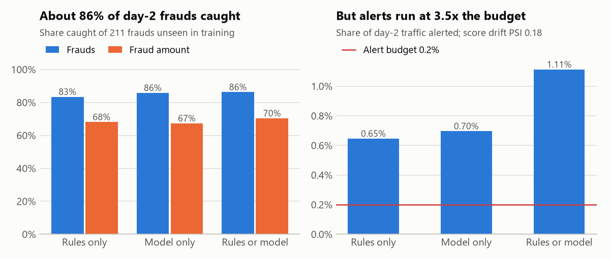
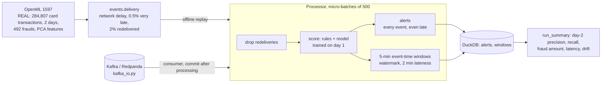

# Real-Time Payments Anomaly Stream

[](https://github.com/Saigwe/payments-anomaly-stream/actions/workflows/ci.yml)

> 284,807 real card transactions replayed as a stream, with the out-of-order arrivals, redeliveries and very late events a real feed has, and scored for fraud in micro-batches by interpretable rules and a gradient-boosted model. Everything is trained on day 1 and tested on day 2: the model catches **181 of 211 day-2 frauds (85.8%)**. Late events are always scored, never dropped.

**Author:** Stanley Igwe, Lead Data (Analytics) Engineer · [Portfolio](https://saigwe.github.io)
**Stack:** Python · scikit-learn · DuckDB · Kafka (Redpanda) wrappers · GitHub Actions
**Status:** ✅ pytest 7/7. CI downloads the data, checks its sha256, replays the full stream and tests the results.

At PwC I built near-real-time transaction and risk-indicator datasets for banking clients, with audit-ready validation. This project is project 3 of my portfolio plan: the streaming side of that work, on a public dataset of real (anonymised) card transactions. No client data is used.

---

## 90-second summary
| | |
|---|---|
| **Problem** | Fraud has to be caught as the transaction arrives, from a feed that delivers events late, out of order and sometimes twice, and analysts can only review a few hundred alerts a day. |
| **What I built** | A broker-agnostic stream processor: it deduplicates redeliveries, scores every transaction with rules and a model trained on the previous day, raises alerts, and keeps 5-minute monitoring windows with a watermark. The offline replay and the Kafka consumer feed the same processor. |
| **Why it matters** | Fraud alerts can't be lost to late data. Monitoring windows mustn't silently change after they're published. Both must hold at once, and here both are tested. |
| **Proof** | Day 2, never seen in training: the model alone catches 85.8% of frauds and 67% of the fraud amount, at 18.6% precision. 500-transaction batches process in about 13 ms (p50). But the alert threshold, set on day 1, alerts on 0.70% of day-2 traffic against a 0.2% budget, and the README explains why. See [Results](#results). |

## Charts
Rendered from this repo's own results by `charts/make_charts.py` (`make charts`); CI re-renders them on every push.



## Architecture


## Data
The [credit card fraud dataset](https://www.openml.org/d/1597) from the Machine Learning Group at ULB (Dal Pozzolo, Caelen, Johnson and Bontempi, 2015), via OpenML: 284,807 transactions by European cardholders over two days in September 2013, 492 of them fraud (0.17%). For confidentiality the bank released 28 PCA components (V1–V28) instead of the original fields, plus seconds since the first transaction and the amount. The currency isn't stated.

There's no card or customer id, so per-card velocity features (the usual heart of streaming fraud detection) aren't possible here; the README says so rather than inventing ids.

**Delivery is simulated, the transactions are not.** Each transaction arrives after a network delay (median 1.6 s), 0.5% arrive 6–30 minutes late, and 2% are delivered twice (fixed seed).

## How it scores
- **Train on day 1, test on day 2.** Nothing from day 2 is used to build rules, train the model or set thresholds.
- **Rules:** the three features where day-1 fraud sits furthest below genuine traffic (V14, V17, V12). Each flags values below the 0.2nd percentile of day-1 genuine transactions. They're simple enough to explain to an analyst.
- **Model:** gradient-boosted trees (scikit-learn) on V1–V28 and log amount, trained on day 1 up to 18:00. The alert threshold is set on day 1 from 18:00 to midnight so that alerts cover an **alert budget** of 0.2% of transactions (about 280 a day), the number analysts can review.
- **Never drop a fraud alert.** An event behind the watermark is still scored and can still alert. It's only left out of the monitoring windows that have already been finalised.
- **Effectively once.** Redeliveries are dropped by transaction id before scoring, so an alert is never raised twice.

## Results
From `make all` (full stream, both days).

**Day 2, out of time (140,021 transactions, 211 frauds):**

| | Alerts | Frauds caught | Precision | Recall | Fraud amount caught |
|---|---:|---:|---:|---:|---:|
| Rules only | 904 | 176 | 19.5% | 83.4% | 18,308 of 26,889 (68%) |
| Model only | 975 | 181 | 18.6% | 85.8% | 18,090 of 26,889 (67%) |
| Rules or model | 1,558 | 182 | 11.7% | 86.3% | 18,920 of 26,889 (70%) |

What it says:
- **Three simple rules nearly match the model.** On this data the rules catch 176 frauds to the model's 181, at similar precision. Combining them adds one fraud for 60% more alerts, so I'd run the model and keep the rules as the explainable fallback.
- **The alert budget didn't hold, and that's the main production lesson.** The threshold was tuned on day-1 evening traffic. On day 2 the model alerts on **0.70%** of transactions, 3.5 times the 0.2% budget. The score distribution shifted between days (PSI 0.18, moderate drift). In production I'd set the threshold as a rolling quantile of recent scores, or re-tune it daily, and alert on drift.
- **A third of the fraud amount gets through.** Each approach catches about 86% of frauds but only 67–70% of the amount, so the misses skew larger. A cost-weighted model (weighting by amount) is the next step.

**Stream behaviour:**

| Measure | Value |
|---|---|
| Messages delivered / redeliveries ignored / transactions processed | 290,355 / 5,548 / **284,807 (each exactly once)** |
| Events arriving over 5 minutes late | 1,410, **all scored**; 10 raised alerts |
| Late events kept out of finalised windows | 1,381 |
| Monitoring windows finalised (5 minutes) | 576 |
| Batch of 500 transactions | about 13 ms p50 and 16 ms p99 on a laptop (about 0.03 ms per transaction); varies by run |

No fraud happened to arrive late in this replay (0.5% of 492 frauds is about 2, and none fell in that 0.5%). So a unit test builds a stream where one does, and proves it is still alerted while the closed window stays unchanged.

## Tests
- `test_redeliveries_are_processed_once`: a message delivered three times is scored and alerted once.
- `test_a_late_fraud_is_still_alerted_but_does_not_change_a_closed_window`: a fraud 29 minutes late raises its alert, counts as late, and doesn't touch the published window.
- `test_windows_count_every_on_time_transaction_once` and a delivery test: every transaction is delivered, about 2% twice, in arrival order.
- On the full replay: every transaction processed exactly once; day 2 is out of time and both approaches catch at least 80% of fraud; late events are scored, not dropped.

## Kafka
`stream/kafka_io.py` wraps the same `Processor` in a Kafka producer and consumer: keyed by transaction id, committing offsets only after a batch is processed. `docker compose up -d` starts a single-node Redpanda. **The wrappers haven't yet run against a live broker; CI tests the processing logic, which is where the guarantees live.**

## Run it
```bash
pip install -r requirements.txt
make all          # download (73 MB, sha256-checked) -> replay -> score -> pytest
```

## Roadmap
- [x] Real transactions replayed with delay, late events and redeliveries; rules and model trained on day 1, tested on day 2
- [x] Never-drop alerting with watermarked monitoring windows; idempotent processing; latency and drift reported
- [ ] Rolling-quantile alert threshold, so the alert budget holds under drift
- [ ] Amount-weighted model, to catch more of the fraud value
- [ ] Run the Kafka wrappers against Redpanda in CI
- [ ] 3-minute Loom walkthrough ([script ready](docs/walkthrough.md))

## Data and licence
- **Transactions:** ULB Machine Learning Group, *Credit Card Fraud Detection* (Dal Pozzolo et al., 2015), published openly on OpenML (dataset 1597). Please cite: A. Dal Pozzolo, O. Caelen, R. A. Johnson and G. Bontempi, *Calibrating Probability with Undersampling for Unbalanced Classification*, IEEE CIDM 2015. The data is downloaded, not redistributed.
- **Code:** MIT (see `LICENSE`).
